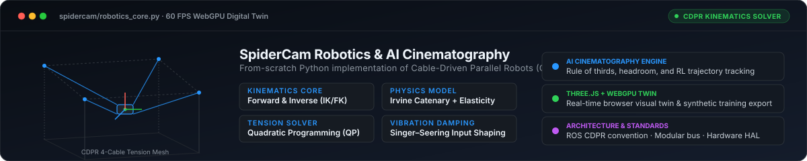
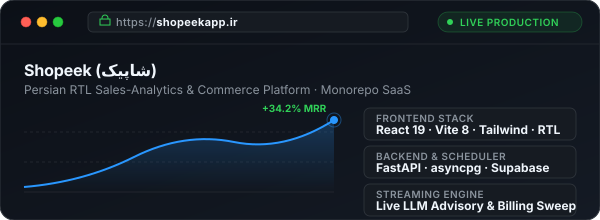
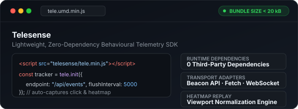

  

    

  

  

    
    
    
    
  

---

### ⚡ About Me

I'm a 17-year-old student and programmer who loves building things from scratch. I spend my time exploring robotics simulations, lightweight web tools, and full-stack web applications.

- 🤖 **Robotics &amp; Simulation**: Working on **SpiderCam**, a cable-driven parallel robot (CDPR) simulation in Python featuring kinematics solvers, catenary cable sag modeling, and an interactive Three.js/WebGPU twin in the browser.
- 📡 **Web Tools**: Built **Telesense**, a lightweight, zero-dependency telemetry script (<20 kB) for capturing user interactions and generating heatmaps.
- 🛒 **Full-Stack Projects**: Developed the frontend and core parts of **Shopeek** ([ShopeekApp.ir](https://shopeekapp.ir)), a Persian RTL sales-analytics web app built with React 19, TypeScript, and FastAPI.
- 💡 **How I Build**: I prefer clean code, minimal dependencies, simple interfaces, and actually understanding how things work under the hood.

---

### 🛠️ Tech Stack &amp; Tooling

| Domain | Technologies |
| :--- | :--- |
| **Languages** |        |
| **Robotics &amp; Simulation** |      |
| **Frontend &amp; Web** |      |
| **Backend &amp; Cloud** |       |

---

### 🚀 Featured Projects

#### 🌐 Flagship Projects

  

  👉 <a href="https://github.com/Subject-Team/SpiderCam"><b>Explore SpiderCam Repository →</b></a>

 

<table width="100%" border="0">
  <tr>
    <td width="50%" valign="top">
      

        
      

      

        <b>Persian RTL Sales-Analytics Platform.</b> Multi-tenant web app built with React 19, TypeScript, and FastAPI. Features Jalali calendar support, automated billing sweeps, and real-time streaming AI chat.
      

      

        👉 <a href="https://shopeekapp.ir"><b>Launch ShopeekApp.ir ↗</b></a> · <a href="https://github.com/Subject-Team/ShopeekFrontend"><b>Frontend Repository</b></a>
      

    </td>
    <td width="50%" valign="top">
      

        
      

      

        <b>Lightweight, zero-dependency behavioral telemetry SDK.</b> Drop a single script tag into any web app to capture clicks, scrolls, keypresses, and heatmap telemetry with a clean JavaScript/TypeScript API.
      

      

        👉 <a href="https://github.com/EbParsa/Telesense"><b>GitHub</b></a> · <a href="https://EbParsa.github.io/Telesense/"><b>Live Demo ↗</b></a> · <a href="https://www.npmjs.com/package/telesense"><b>npm Package</b></a>
      

    </td>
  </tr>
</table>

#### 🔍 Project Highlights &amp; Technical Details

  
<b>Click to view technical details of each project</b>

   

  - **🛒 Shopeek (Sales Analytics Platform — [ShopeekApp.ir](https://shopeekapp.ir))**
    - *What I Worked On*: Built the frontend interface with React 19, RTL layout (Vazirmatn font), multi-account handling, and contributed to the FastAPI backend scheduler.
    - *Backend Details*: FastAPI + SQLAlchemy async with `asyncpg` against Supabase Postgres. Tehran midnight automated billing sweep (`scheduler_state` persistence), 30-day period ticks, and Telegram bot notification integration.
    - *Frontend Details*: React 19 + TypeScript + Vite + Tailwind CSS with full Persian RTL typography and multi-tenant isolation.
    - *Stack*: React 19, TypeScript, Next.js, FastAPI, PostgreSQL, Supabase, Tailwind CSS, Docker.

  - **🤖 SpiderCam (Cable-Driven Parallel Robot &amp; Physics Simulation)**
    - *What I Worked On*: Implemented forward and inverse kinematics solvers, catenary sag modeling, tension distribution, and the Three.js/WebGPU web simulation.
    - *Kinematics &amp; Statics*: Inverse and forward kinematics solver using platform structure matrices, pose representations, and force distribution algorithms conforming to international CDPR conventions.
    - *Physics &amp; Mechanics*: Irvine catenary cable sag modeling + elasticity compensation, Quadratic Programming (QP) solver for optimal cable tension distribution, and Singer–Seering input shaping for anti-sway vibration damping.
    - *Simulation &amp; Twin*: Three.js + WebGPU interactive real-time visual twin, synthetic training data generation, and WebSocket/gRPC bus architecture.
    - *Stack*: Python 3.12, NumPy, SciPy (QP Optimization), Three.js, WebGPU, WebSocket IPC.

  - **📡 Telesense (Ultra-Lightweight Behavioral Telemetry SDK)**
    - *What I Worked On*: Designed a zero-dependency telemetry script minified under 20 kB, with batch event dispatching (Beacon / Fetch) and heatmap visualization.
    - *Architecture*: Sub-20 kB bundled script with zero runtime dependencies. Client-side event aggregation with automated batching and flush intervals. Custom transport adapters (Beacon API, fetch, WebSocket).
    - *Visualizations*: Real-time coordinate normalization across heterogeneous viewport resolutions for accurate click/scroll heatmaps and event timeline replays.
    - *Stack*: TypeScript, Rollup/Vite, UMD/ESM dual exports, Web APIs.

---

### 📊 GitHub Activity &amp; Metrics

  <table border="0">
    <tr>
      <td>
        
      </td>
      <td>
        
      </td>
    </tr>
    <tr>
      <td colspan="2" align="center">
        
      </td>
    </tr>
    <tr>
      <td colspan="2" align="center">
        
      </td>
    </tr>
  </table>

---

### 🐍 Contribution Graph

  

---

  Crafted by <a href="https://github.com/EbParsa">Parsa Ebrahimi</a> · Always building and learning.

