  

    

  

  

    
    
    
    
  

---

### ⚡ About Me

I am a **Robotics, Systems & Full-Stack Engineer** focused on building high-performance, lightweight, and resilient software architectures. My work spans specialized robotics and physical simulations (cable-driven parallel robots, kinematics, WebGPU digital twins) alongside production enterprise platforms and developer tooling (Next.js, FastAPI, zero-dependency telemetry SDKs, and streaming AI interfaces).

- 🤖 **Robotics & Simulation**: Engineering **SpiderCam**, a cable-driven parallel robot (CDPR) platform featuring forward/inverse kinematics, Irvine catenary sag compensation, anti-sway vibration damping, AI-assisted directing, and a real-time WebGPU digital twin.
- 📡 **Telemetry & Developer Tooling**: Author of **Telesense**, a zero-dependency behavioral telemetry SDK minified under 20 kB with custom transport pipelines and live heatmap visualization.
- 🛒 **Full-Stack & Distributed Systems**: Core frontend & full-stack architect of **Shopeek**, an enterprise Persian RTL sales-analytics platform featuring multi-tenant isolation, Jalali calendar systems, usage-based billing sweeps, and real-time streaming AI chat.
- 💡 **Core Engineering Values**: Zero unnecessary dependencies, mathematically sound kinematics, predictable performance, and intuitive developer ergonomics.

---

### 🛠️ Tech Stack & Tooling

| Domain | Technologies |
| :--- | :--- |
| **Languages** |        |
| **Robotics & Simulation** |      |
| **Frontend & Web** |      |
| **Backend & Cloud** |       |

---

### 🚀 Featured Work & Engineering Portfolio

#### 🌐 Core Projects

<table>
  <tr>
    <td width="50%" valign="top">
      <h3 align="left">🛒 <a href="https://shopeek-frontend.vercel.app">Shopeek</a></h3>
      
<b>Persian RTL Sales-Analytics &amp; E-Commerce Platform.</b> Enterprise multi-tenant SaaS engineered with React 19, TypeScript, and FastAPI. Features Jalali calendar systems, Tehran midnight billing sweeps, and real-time streaming LLM advisory chat.

      

        
        
        
      

      
👉 <a href="https://github.com/Subject-Team/ShopeekFrontend"><b>Frontend Repository</b></a> · <a href="https://shopeek-frontend.vercel.app"><b>Live Application →</b></a>

    </td>
    <td width="50%" valign="top">
      <h3 align="left">📡 <a href="https://github.com/EbParsa/Telesense">Telesense</a></h3>
      
<b>Lightweight, zero-dependency behavioral telemetry SDK.</b> Drop a single script tag into any web app to capture clicks, scrolls, keypresses, and heatmap telemetry with a clean JavaScript/TypeScript API.

      

        
        
        
      

      
👉 <a href="https://github.com/EbParsa/Telesense"><b>GitHub</b></a> · <a href="https://EbParsa.github.io/Telesense/"><b>Live Demo →</b></a> · <a href="https://www.npmjs.com/package/telesense"><b>npm Package</b></a>

    </td>
  </tr>
  <tr>
    <td width="100%" colspan="2" valign="top">
      <h3 align="left">🤖 <a href="https://github.com/Subject-Team/SpiderCam">SpiderCam</a></h3>
      
<b>Cable-Driven Parallel Robot (CDPR) &amp; AI Cinematography Platform.</b> From-scratch Python robotics implementation solving forward/inverse kinematics, Irvine catenary sag and elasticity compensation, optimal QP tension distribution, anti-sway vibration damping (Singer–Seering input shaping), and real-time Three.js + WebGPU digital twin simulation.

      

        
        
        
        
        
      

      
👉 <a href="https://github.com/Subject-Team/SpiderCam"><b>Explore SpiderCam Repository →</b></a>

    </td>
  </tr>
</table>

#### 🏛️ Case Studies & Engineering Architecture

  
<b>Click to view selected engineering and systems deep dives</b>

   

  - **🛒 Shopeek (Enterprise Sales Analytics &amp; E-Commerce Platform)**
    - *Role & Scope*: Frontend & full-stack architect leading multi-account session management, Jalali RTL calendar date systems, credit/usage billing quota subsystems, and real-time streaming LLM assistant advisory interfaces.
    - *Backend Architecture*: FastAPI + SQLAlchemy async with `asyncpg` against Supabase Postgres. Tehran midnight automated billing sweep (`scheduler_state` persistence), 30-day period ticks, and Telegram bot notification integration.
    - *Frontend Architecture*: React 19 + TypeScript + Vite + Tailwind CSS with full Persian RTL typography (Vazirmatn font) and end-to-end multi-tenant isolation.
    - *Stack*: React 19, TypeScript, Next.js, FastAPI, PostgreSQL, Supabase, Tailwind CSS, Docker.

  - **🤖 SpiderCam (Cable-Driven Parallel Robot &amp; AI Physical Simulation)**
    - *Role & Scope*: Primary engineer designing core kinematics, catenary physics compensation, and digital twin simulation.
    - *Kinematics & Statics*: Inverse and forward kinematics solver using platform structure matrices, pose representations, and force distribution algorithms conforming to international CDPR conventions.
    - *Advanced Physics*: Irvine catenary cable sag modeling + elasticity compensation, Quadratic Programming (QP) solver for optimal cable tension distribution, and Singer–Seering input shaping for anti-sway vibration damping.
    - *Simulation & Twin*: Three.js + WebGPU interactive real-time visual twin, synthetic training data generation, and WebSocket/gRPC bus architecture.
    - *Stack*: Python 3.12, NumPy, SciPy (QP Optimization), Three.js, WebGPU, WebSocket IPC.

  - **📡 Telesense (Ultra-Lightweight Behavioral Telemetry SDK)**
    - *Role & Scope*: Author and lead developer of a zero-dependency behavioral telemetry and analytics library.
    - *Architecture*: Sub-20 kB bundled script with zero runtime dependencies. Client-side event aggregation with automated batching and flush intervals. Custom transport adapters (Beacon API, fetch, WebSocket).
    - *Visualizations*: Real-time coordinate normalization across heterogeneous viewport resolutions for accurate click/scroll heatmaps and event timeline replays.
    - *Stack*: TypeScript, Rollup/Vite, UMD/ESM dual exports, Web APIs.

---

### 📊 GitHub Activity & Metrics

  <table border="0">
    <tr>
      <td>
        
      </td>
      <td>
        
      </td>
    </tr>
    <tr>
      <td colspan="2" align="center">
        
      </td>
    </tr>
    <tr>
      <td colspan="2" align="center">
        
      </td>
    </tr>
  </table>

---

### 🐍 Contribution Graph

  

---

  Designed &amp; crafted with care by <a href="https://github.com/EbParsa">Parsa Ebrahimi</a>. Constantly building, learning, and optimizing.

